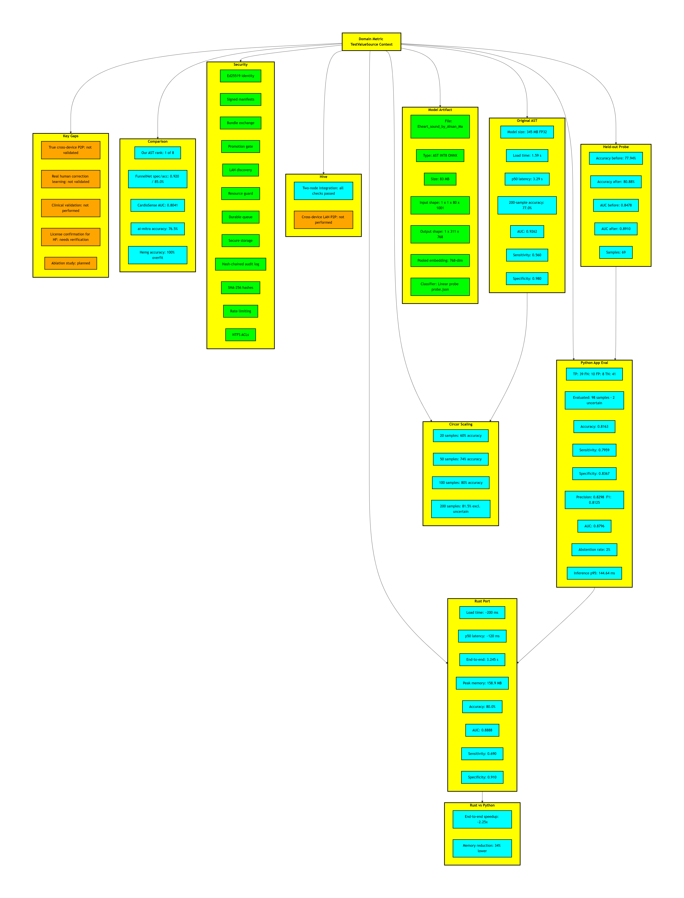
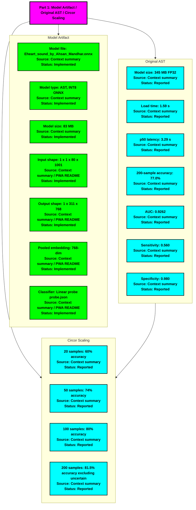
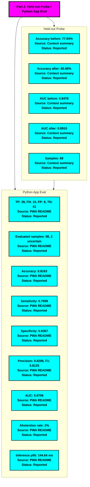
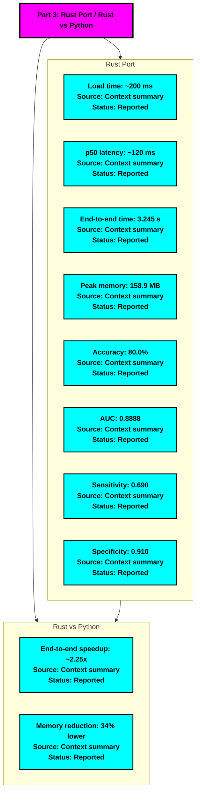
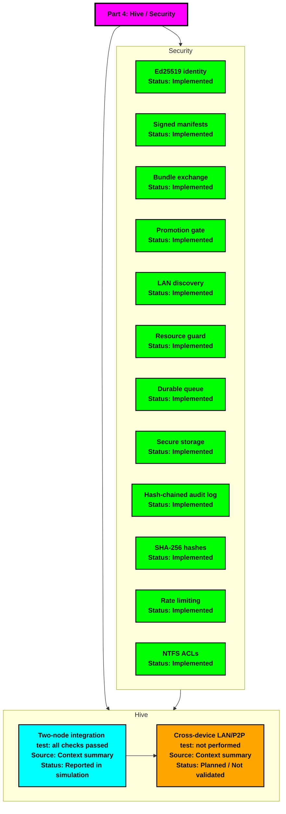
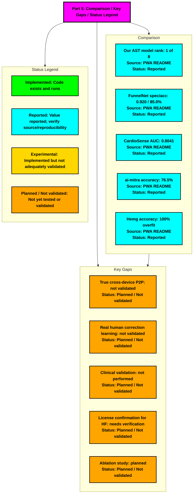

# Master Metrics - Heart Murmur Agentic Hive



# Part 1: Model Artifact / Original AST / Circor Scaling


```
# Part 2: Held-out Probe / Python App Eval


```
# Part 3: Rust Port / Rust vs Python


```
# Part 4: Hive / Security


```
# Part 5: Comparison / Key Gaps / Status Legend


```