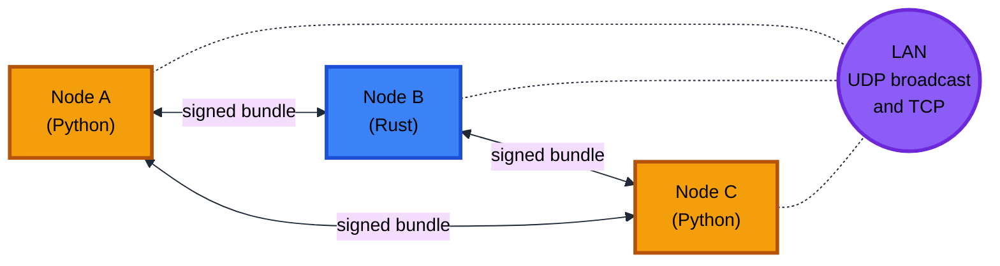
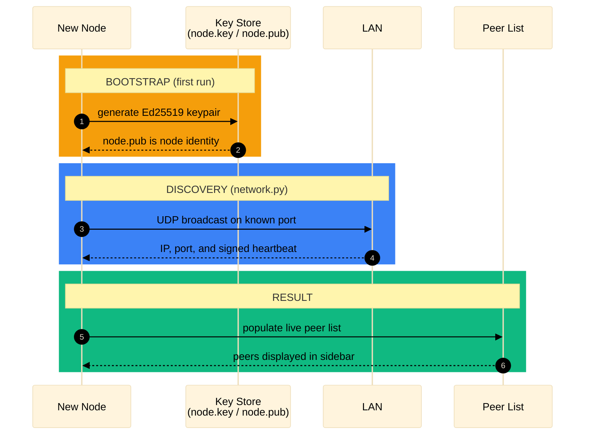
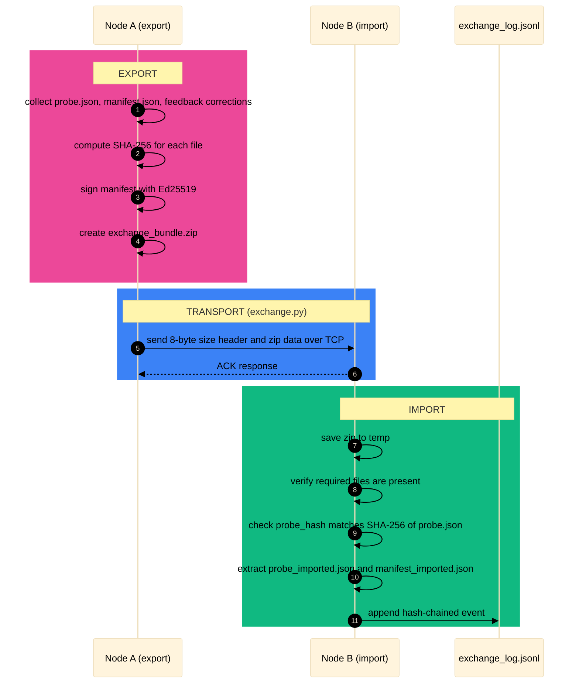
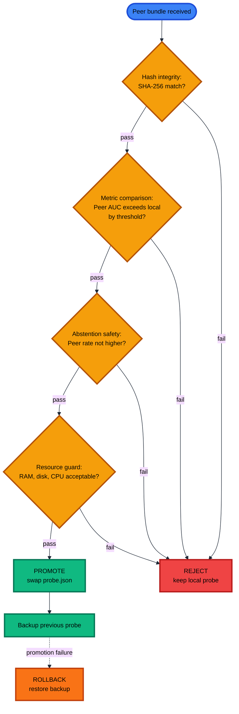
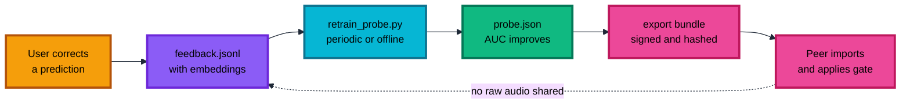
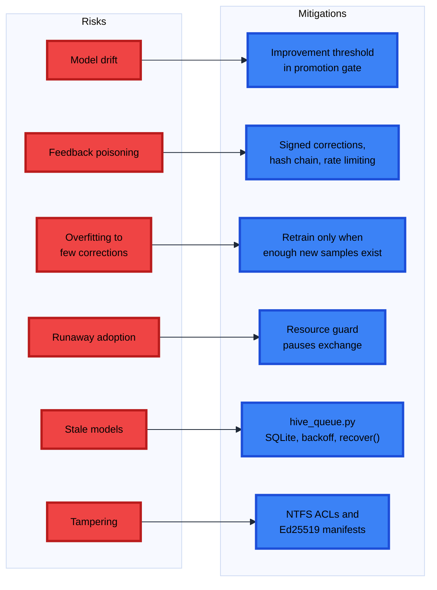
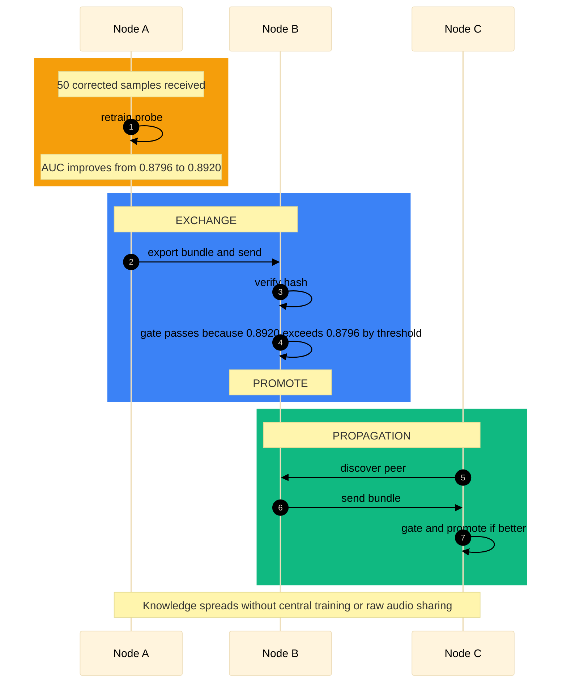

# Heart Murmer Agentic Hive

A multi-agent heart sound (murmur) detector with federated learning, P2P exchange, and security hardening.

## Features
- **Multi-agent pipeline:** preprocessing, inference, decision, safety, visualization.
- **ONNX Runtime** (CPU) with AST model (~83 MB).
- **Linear probe** for murmur detection.
- **P2P exchange:** signed bundles, promotion gate, rollback.
- **Security:** Ed25519 identity, hash verification, rate limiting, resource guard, durable queue, NTFS ACL, audit log hash chain.
- **LAN discovery:** UDP broadcast peer discovery.
- **Rust port:** one-click installer (no dependencies).
- **Human-in-the-loop:** correction feedback.

## How to use
### Python (Streamlit)
1. Install Python 3.10+.
2. Run `setup.bat` (creates venv, installs deps, downloads model).
3. Run `run.bat` → opens http://localhost:8501.
4. Upload a heart-sound audio file → click Analyze.

### Rust (one-click)
1. Download `heart-murmer-agentic-hive-setup.exe`.
2. Run installer → launch from Start Menu.

## License
Dual license: MIT for base components; copyright © 2026 Ahsan Mandhar for applied technology. See LICENSE.md.

## Citation
If you use this work in research or presentation, please credit: Ahsan Mandhar.
## Download

### Python (one-click installer — recommended for lay users)

### Rust (one-click installer — CLI)

### Python (source)

### Network Topology

### Node Bootstrap & Discovery

### Bundle Exchange Protocol

### Promotion Gate

### Training Flow (No Raw Audio Sharing)

### Risk Mitigation

### End-to-End Propagation

